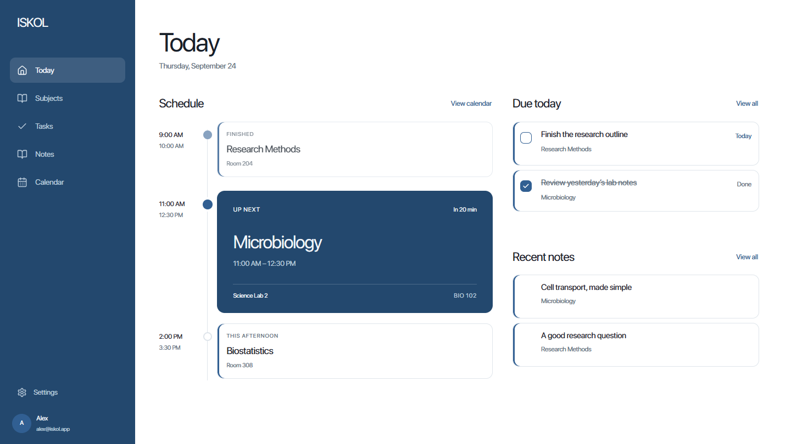
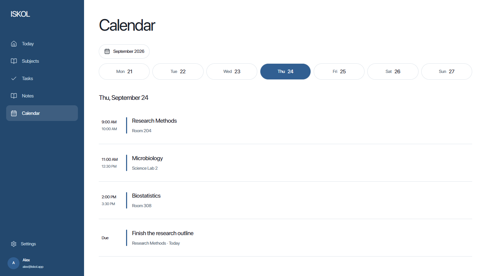

# ISKOL

ISKOL is a web planner for students managing a semester of classes, assignments, and study notes. Set up your subjects and recurring class times once, then use the dashboard each day to see where you need to be and what work is still due.

*Today dashboard from the ISKOL design preview, shown with sample student data.*

## Plan your school day

- **Start with today.** Check upcoming classes and pending schoolwork on the dashboard.
- **Build your timetable.** Save each subject's course code and instructor, add weekly meeting times and rooms, and use the calendar to see when classes meet.
- **Find your study notes.** Link notes to a subject to keep lecture material and review notes together, or save a standalone note for quick reference.

*Calendar from the ISKOL design preview, shown with a sample class schedule.*

## Run locally

ISKOL is built with Next.js, TypeScript, and Tailwind CSS. Sign-in and student workflows require a Supabase project with the ISKOL database schema and access policies configured.

1. Install dependencies with `npm ci`.
2. Copy [`.env.example`](.env.example) to `.env.local` and fill in your project settings there. The example contains placeholders only.
3. Run `npm run dev` and open `http://localhost:3000`.
